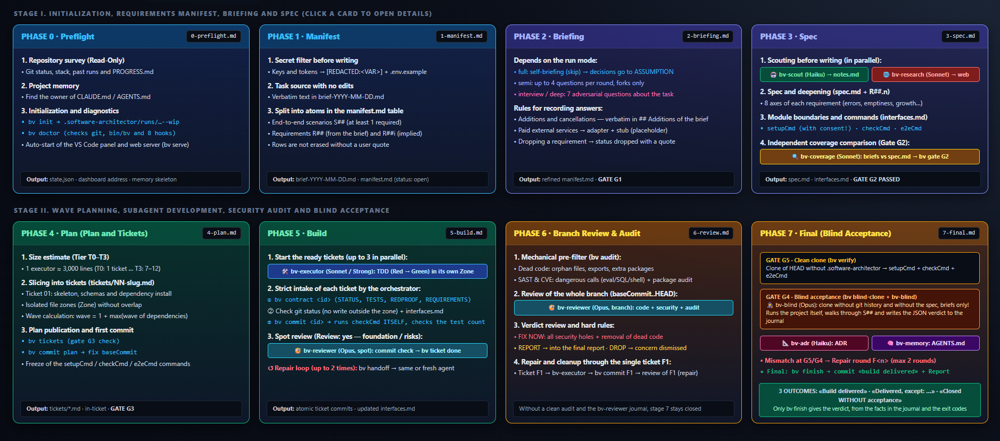

# Software-Architector — a Claude Code plugin



Turns a dictated idea into a finished project in one conversation: requirements → briefing → spec → tickets → executor subagents → code review with a junk-code and security audit → blind acceptance. You can see the progress, down to every action of every agent, on the panel on the right in VS Code.

Created by Shleyger Ram.

## What "delivered" means

`bv` accepts a build based on facts, not on the model's words. `bv finish` refuses until all of this is proven:

| What | How it is proven |
|---|---|
| The project is green on every ticket | `bv commit` runs the check itself and reads the exit code and the number of tests. An empty suite, an unrecognized test count, a hang or missing tests count as red. The check commands are frozen from the start of development: a change needs a reason, and the reason goes into the report |
| The project works for an outsider | `bv verify` (gate G5): a clean clone of the current commit, install, check, end-to-end tests |
| The parts work together | Scenarios `S##` (at least one is required): an automated test and a manual walkthrough at the blind acceptance |
| Everything promised is built | Every manifest row is delivered, none is erased and none is marked by hand |
| The checkers really did their work | The hook journal confirms that the reviewer (of this exact ticket), the coverage check and the acceptance finished work at the right moment. `bv` takes the coverage and acceptance verdicts from their final answer in the journal, not from the orchestrator's words |
| The code is clean and safe | `bv audit` (phase 6): secrets and key files in the tree, dangerous calls, junk code (debug leftovers, unused files, exports and packages), dependency CVEs (`npm audit`, `pip-audit`, `cargo audit`, when installed). The reviewer confirms or refutes each finding. `bv finish` refuses on a missing or stale audit and on a `blocker`/`high` finding that is neither fixed nor accepted with a written reason |
| The task is solved | The blind acceptance answers separately whether the user's task is solved |
| What is checked is exactly what is delivered | G4, G5 and the audit are tied to a commit and become stale at any new commit |

`bv audit` writes the full list of findings to `audit.md` in the run folder, and `bv status` shows its summary. The panel and the web dashboard do not show the audit yet.

The result has three possible forms, and the user hears it first:
- **"Build delivered":** everything above is proven;
- **"Build delivered, except: S03, R10":** the named rows cannot be truly checked in a run (they need your key or a real email or payment). The code and a stub exist, and you check them yourself once;
- **"Build closed WITHOUT acceptance":** a ticket failed, or two repair attempts did not help, or something blocks the build that only the user can remove.

**What this does not guarantee.** This protects against a false "done". It is not a mathematical proof that there are no errors:
- end-to-end tests and acceptance check only what is written in the requirements, so nobody checks a requirement that nobody stated;
- services replaced by stubs (payments, real emails) are not truly called in a run, and the report names them in the section "How it was checked";
- `bv audit` is a heuristic pre-filter, not a full SAST: it reads patterns line by line, sees no data flow between files, and may flag live code as unused (dynamic imports) or miss it (a name mentioned anywhere counts as used). A scanner that is not installed or has no network is reported as "not checked", never as clean;
- the check runs on your machine, so other operating systems, browser versions and real load are not checked;
- the protection is built for the model's errors and haste, not for deliberate deception: the journal and the manifest are in the project folder (see "What is protected hard").

## Requirements

- Claude Code 2.1.310+ (VS Code or terminal)
- Python 3.9+ (standard library only), git 2.32+
- Windows: Git Bash (Claude Code requires it anyway)

## Installation

In Claude Code (VS Code or terminal), once. The first command adds this GitHub repository as a plugin marketplace, the second installs the plugin from it:

```
/plugin marketplace add shleyger-dotcom/Software-Architector
/plugin install software-architector@software-architector
```

Run `/reload-plugins` or restart Claude Code, then ask Claude to run `bv doctor` (it checks git, hooks and the state schema). To update later: `/plugin marketplace update software-architector`.

To develop the plugin without installing it, run this in a terminal from the folder of the repository clone (PowerShell or Git Bash, no administrator rights needed):

```bash
claude --plugin-dir .
```

## Start

```
/software-architector:build [full|semi|interview] [strict|deep] <idea or path to brief.md>
```

| Mode | When it asks |
|---|---|
| `full` — "full auto", "ask me nothing" | only before something irreversible (deploy, payment, publication, deletion) |
| `semi` — the default | only at forks that lead to different products |
| `interview` — "grill me", "interrogate me" | all questions + an adversarial pass |

Depth: `strict` — only what is needed, `normal` — the default, `deep` — all dimensions of every requirement.

`/software-architector:build` without arguments resumes an interrupted run.

## Run panel in VS Code

When you start `/software-architector:build`, the Software-Architector panel opens by itself to the right of the chat:

- header: mode, depth, tier, how long the run has gone, the token total, the time of the last event (a yellow "silence" if there are no events for more than 5 minutes);
- **"⏸ Waiting for you"** with the text of the question, when the orchestrator has asked a question or has ended its turn and waits for an answer;
- gates G1–G5 with names and the time they passed (`● running` while the checking agent works);
- stages with time, tickets under "Build" (wave, model, tests, repairs/retries, commit, time), and under the stages and tickets, their **agents**. For a working agent you see its current action (`↳ Bash pytest … · 12s ago`). Finished agents without errors are collapsed; press `a` to show them;
- an agent shows `✗N` for failed calls, a gray `✗N` for a red test that the same agent later saw green (normal for "test first"), and `⛔N` for guard blocks;
- a click on an agent shows a summary (tools, changed files — a click copies the path, the last error, the result — in full with `f`) and all actions, newest on top; `e` shows only errors. A click on an action shows the **full input and output of the tool**; `p`/`n` move to the neighboring calls, `c` copies the output path.

If you close the panel, the data is not lost. To bring it back:

- the **"Panel"** button in the strip above the input box (visible while the project has a run; from the keyboard — `Ctrl+X Tab`, then `b`). The same strip shows the stage, the tickets, the current action, the `✗`/`⛔` counters and "waiting for you";
- the command `/bv-panel`;
- on an important event (a gate failed, a stage failed, a guard block, the build delivered or not accepted) a notification with a hint appears.

You need a Claude Code with support for plugin modules (tested on 2.1.312).

## Web dashboard

A local server (`127.0.0.1` only) at an address like `http://localhost:87NN/?k=<key>` shows the same as the panel: "waiting for you", gates, the tree stage → tickets → agents, current actions, silence, `✗`/`⛔`. A click on an agent opens a card on the right (below on a narrow screen) with the summary, files, result, the error filter and the full output of calls. The keys are the same: `a`, `e`, `f`, `p`/`n`, `Esc`. The port is fixed for the project, and the page refreshes every 2 s. Without the random key from the address (new at every server start) the server returns nothing. `bv url` prints the address with the key. There is one server per project.

Open it in a browser at any time while the project has a run:

- the **"Web"** button in the strip above the input box (`Ctrl+X Tab`, then `w`) or **"Open in browser"** in the panel;
- the command `/bv-web`;
- from a terminal: `bv web` (PowerShell, cmd or Git Bash, no administrator rights needed).

If the server is not running, `bv web` starts it as a separate process. It keeps running after the session closes, until `bv finish` closes the run (it stops the server), you stop it by hand, or you restart the computer.

## Agent journal

The hooks write every action of the agents to `.software-architector/live/<run>/`: `agents/<agent>.jsonl` holds the events, and `out/<call>.txt` holds the full input and output (up to 1 million characters per call). Secrets are masked **before** they are written to disk, by the same rules that block them in commits. The folder stays out of git (`live/.gitignore`) and does not clean itself: you can delete old runs by hand.

## What is protected hard (hooks)

While a run is active in the project:
- the main session (the orchestrator) cannot write project code — only the executors can;
- no agent writes `state.json` or the journal `.software-architector/live/` (neither with a tool nor through the shell): only `bv` and the hooks write them;
- secrets are not written to files and commits, `.env` is not read, and a message with a key does not go to the model;
- `git push` in any spelling (in quotes, `git.exe`, through `-C`/`-c`, a git alias), `npm publish`, `gh repo create --push`, `reset` with a revision, `checkout <revision> <path>`, `clean -f`, `stash`, history rewriting, and `git add` of the whole tree are blocked; letter case and quotes do not help;
- nobody writes to the folder of the plugin itself, to `~/.claude/settings*.json`, to `~/.claude/CLAUDE.md` or to the project's `.claude/settings*.json`; a path that cannot be parsed is refused;
- an executor writes only to the zone of its ticket (plus `.env.example` and dependency files), also through the shell; to `.software-architector/` — never;
- a subagent cannot run `git commit`: only `bv commit` commits, after its own check;
- the blind acceptance and the coverage check do not see the internal records of the run (in any letter case and when searching from the root); the acceptance works in a clone without git history (`bv blind-clone`), writes only into it and does not touch the working folder;
- the reviewer only reads: Bash without writing files and without changing git, also through a nested shell (`bash -c "…"`, `eval`, `bash <<EOF`);
- the researcher, who reads the internet, writes only `research.md`; a secret does not go into a search query or a page address;
- MCP tools that change something or act outside are blocked during a run; the orchestrator starts only the agents `software-architector:bv-*`, and a foreign agent only reads;
- if the guard check fails or does not finish within 10 s, a call that writes (Write/Edit, Bash, an agent, MCP) is not let through;
- if `state.json` is damaged, changes are blocked and do not pass silently; only `bv` itself passes;
- the escape hatches of `bv` need you, not the model: Claude Code asks you to allow `bv set guard=off`, `bv init --force`, `--use-real-env`, `bv tickets --extra-round` (one more repair round past the limit), and in modes semi/interview also `bv set … --reason` (a frozen check command changes) and `bv commit … --fewer-tests`. In mode `full` nobody is asked: `--use-real-env` and `--extra-round` are refused, `--reason` and `--fewer-tests` pass and go into the report. A subagent cannot run any of them;
- `bv audit --accept <id>` lifts a `blocker`/`high` audit finding only when the reviewer's answer in the journal drops it (`DROP: … [<id>] — …`).

This protects against accidental errors of the model. It is not a security boundary: the rules are regular expressions over the command text. You can bypass them on purpose (for example, run a script file that writes into the project, build a command from variables, call a pre-configured git alias or `Start-Process`). The guard learns the zone of a ticket from the description of the agent call ("Ticket 02: …"); without it, an executor can write to the zones of all tickets in flight. The number of tests is counted for the whole project, not for a ticket. Do not start a run on a machine or in a repository where a model error is not acceptable.

## Agent models

| Agent | Model | Why |
|---|---|---|
| executor | Sonnet for a regular ticket, the session model for a hard one | cost |
| reviewer, blind acceptance | Opus | the checker is not weaker than the one it checks |
| researcher, coverage | Sonnet | reading and comparing texts |
| scout, memory, ADR | Haiku | search and retelling |

The researcher (`bv-research`) checks on the internet, before the spec, everything external that the task depends on: library versions, exact API calls, limits, licenses. The result, with source addresses and the date of the check, is in `research.md`. The spec and the executors take facts from it, not from the model's memory.

Check the installation with `bv doctor` (git, `bin/bv`, all 8 hooks, the state schema; with an open run it also checks that the hooks really fire). `bv contract <ticket> --from -` checks the executor's contract, and `bv handoff <ticket> --note "…" --tail -` builds the package for a repair.

Emergency switch: `bv set guard=off` (Claude Code asks you to allow it; visible in the status and the journal).

## Structure

| Path | What |
|---|---|
| `skills/build/SKILL.md` | orchestrator |
| `skills/build/phases/` | rules of the phases, read one at a time |
| `agents/` | executor, reviewer, blind acceptance, coverage, scout, researcher, memory, ADR |
| `hooks/hooks.json`, `scripts/guard.py` | hard invariants |
| `scripts/events.py` | journal of the agents' work |
| `scripts/audit.py` | junk-code and security scan behind `bv audit` |
| `hooks/register.tsx`, `types/` | run panel in VS Code, the strip above the input, `/bv-panel`, `/bv-web` |
| `scripts/bv.py`, `bin/bv` | run bookkeeping: stages, gates, tickets, commits, server |
| `scripts/dashboard.html`, `monitors/monitors.json` | web dashboard and its start |
| `tests/`, `.github/workflows/test.yml` | unit and panel tests, CI on Linux, Windows and macOS |
| `software-architector-workflow.html` | diagram of the whole workflow: phases, gates, agents, hooks |

## Tests

PowerShell or Git Bash, from the plugin root, no administrator rights needed:

```bash
python -m unittest discover -s tests
claude plugin test .
```
